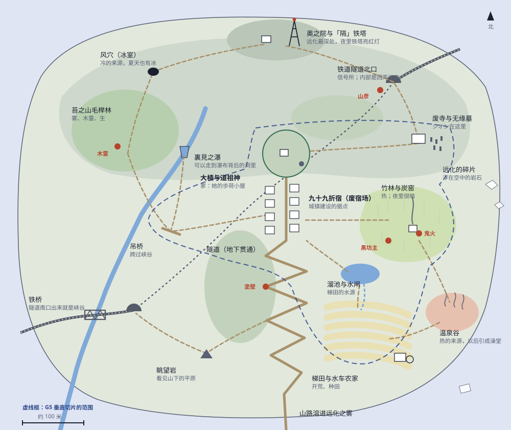

# 新手区地图 v2：九十九折峠（G2 草案）

> 状态：**草案，待审批**（2026-10-14）。用户要求比 v1 草案更复杂、更多样（D10）。依据：`docs/knowledge/01`（引力、三角形法则、塔、四拍教学）。

## 尺度与结构

- 约 830 × 690 米（游戏内），跑步横穿约三分钟。比 v1 草案（560 × 470 米）大约一倍。
- **三层高度 + 地下**：
  - **上层**：山顶的奥之院与「隔」铁塔、风穴（冰室）、铁道隧道北口、废寺与无缘墓、苔之山毛榉林。
  - **中层**：峠顶的大楠与道祖神（家）、九十九折宿（废宿场，城镇建设据点）、竹林与炭窑、裏見之瀑、吊桥。
  - **下层**：峡谷与铁桥、溜池与水闸、梯田与水车农家、温泉谷、九十九折山路、眺望岩。
  - **地下**：铁道隧道从北口贯通到峡谷边的南口，正好从峠顶的正下方穿过：旧路在上，铁路在下。隧道内部是黑暗、回声很大的迷宫（光与音的谜），打通后成为南北之间的近道。
- **四周是远化之雾**：山路走下去会溶进雾里，作用相当于初始台地四周的悬崖。远化的碎片（浮在空中的岩石、悬着的房子）只出现在边缘，并且在剧情里先被看见、被说明。

## 十七个地点

| 地点 | 主导性质 | 玩家在这里做什么 |
|---|---|---|
| 大楠与道祖神（家） | 生（受注连绳保护） | 起点；神棚、归还性质；大楠可以爬，树冠就是"塔" |
| 九十九折宿（废宿场） | — | 城镇建设；旧器物最多（第一批付丧神） |
| 竹林与炭窑 | 熱、暗 | 热的来源；夜里黑坊主和鬼火 |
| 废寺与无缘墓 | 音 | 遇见シオン；钟；盂兰盆的灯 |
| 铁道隧道北口与信号所 | 音、暗 | 山彦；隧道迷宫入口 |
| 奥之院与「隔」铁塔 | 远化 | 谜的灯塔：夜里铁塔亮红灯，从家里就看得见 |
| 风穴（冰室） | 冷（负的热） | 夏天也有冰；冷的来源 |
| 苔之山毛榉林 | 生 | 雾、木霊；生的来源 |
| 裏見之瀑 | 音 | 走到瀑布背后的洞里；取走瀑布的声音，听见被盖住的东西 |
| 吊桥与峡谷 | 重 | 跨过峡谷；朽桥要轻着走 |
| 铁桥与隧道南口 | 重、音 | 地下迷宫的出口；铁道的标志画面 |
| 溜池与水闸 | 重 | 梯田的水源；修水闸 |
| 梯田与水车农家 | 生、光、热 | 开荒、种田；旧农具（付丧神） |
| 温泉谷 | 熱 | 热的来源；以后引成澡堂 |
| 九十九折山路 | 重 | 地藏与供品；塗壁堵路 |
| 眺望岩 | — | 看见山下的平原与遠化 |
| 远化的碎片 | 远化 | 边界；只看，不能进 |

## 路线与回环

- **主路（旧街道）**：家 → 九十九折宿 → 九十九折山路 → 远化之雾。
- **北环**：家 → 废寺 → 隧道北口 → 山顶。
- **西环**：宿场 → 吊桥 → 裏見之瀑 / 山毛榉林 → 风穴 → 山顶。
- **东环**：宿场 → 竹林与炭窑 → 温泉谷 → 梯田 → 溜池 → 宿场。
- **南下**：山路中段 → 眺望岩 → 峡谷 → 隧道南口与铁桥。
- **地下**：隧道贯通南北，打通后是近道。
- **性质捷径**：生的藤蔓梯、取热冻出的冰桥、变轻后被风送过的断崖——熟练的玩家可以抄近路。

## 引导

- **从家里看得见**：山顶铁塔（夜里亮红灯）、炭窑的烟、瀑布的水雾、废寺的钟声。大楠可以爬，树冠上看得见全区，目标围成一圈。
- **三角形法则**：峠顶、山毛榉林的坡、梯田的坡都做成遮挡与揭示——翻过一道坡，才看见下一个目标；始终有目标可见，但不是同一个。
- **引力**：每个地点都给「移」带来回报：值得取的性质、种田需要的东西、可以唤醒的旧器物。通用掉落保持稀缺。
- **声音地标**：瀑布、钟、风铃、遠囃子。神秘的声音都有看得见的声源。
- **夜晚改变引力**：鬼灯和萤火虫只在夜里发光，夜里有只在夜里才出现的东西。
- **教学**：五性各按四拍分布在各地，不强制顺序；提示只在第一次、玩家走近之后出现。

## 请你决定

- 这十七个地点和三层加地下的结构是否同意？要删要加什么？
- 尺度（约 830 × 690 米）是否合适？
- 新手区的终点：山路尽头出现难民（`story.md` 的方案），还是放在隧道或山顶？
